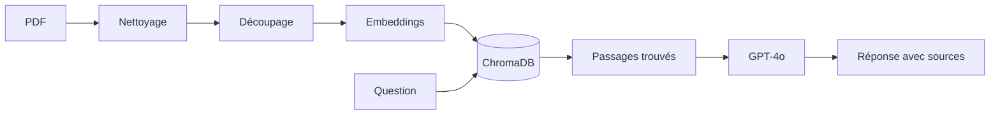

# XK7-RAG

Assistant IA qui répond à des questions sur de la documentation data (bases de données, SQL) en citant les pages utilisées. Si l'information n'est pas dans les documents, il le dit au lieu d'inventer.

C'est un projet personnel. Il servira de base à un futur système multi-agent dédié à la data : documentation, SQL, analyse et qualité des données.

## Pourquoi ce projet

J'ai construit cet assistant pour trois raisons :

- monter en compétence sur l'IA générative appliquée (RAG, embeddings, bases vectorielles) ;
- répondre à un besoin réel : en entreprise, on perd beaucoup de temps à chercher une information dans une documentation volumineuse ;
- avoir un outil utile pour moi au quotidien, une base de connaissances data que je peux interroger en langage naturel.

## Pourquoi pas simplement ChatGPT ou Claude ?

Un assistant grand public répond à partir de ce qu'il a appris sur internet. XK7-RAG répond à partir de vos propres documents. Cela change plusieurs choses.

### Des réponses vérifiables

Chaque réponse cite les pages utilisées. On peut ouvrir le document et vérifier. Avec un assistant grand public, on ne sait pas d'où vient l'information.

### Moins d'inventions

L'assistant a pour consigne de répondre uniquement à partir des passages trouvés. Si l'information n'y est pas, il le dit. Un assistant grand public a tendance à toujours produire une réponse, même quand il ne sait pas.

### Des connaissances propres à l'entreprise

Un modèle grand public ne connaît pas les procédures internes, la documentation d'un projet ou les règles de gestion d'une entreprise. Ici, il suffit d'ajouter les documents dans la base pour que l'assistant puisse s'en servir, sans réentraîner de modèle.

### Des documents toujours à jour

Quand un document change, on met à jour la base. Un modèle grand public reste figé à la date de son entraînement.

### Un meilleur contrôle des données

- Les documents et la base vectorielle restent sur la machine ou sur le serveur de l'entreprise.
- Seuls la question et quelques passages utiles sont envoyés au modèle, jamais le document entier.
- La clé d'API est stockée dans un fichier séparé, exclu du dépôt.
- Le modèle utilisé peut être remplacé. Pour des documents sensibles, on peut utiliser un modèle installé en local, et dans ce cas aucune donnée ne quitte l'entreprise.

Ce n'est pas le cas quand un salarié copie un document confidentiel dans un assistant grand public.

### Un coût maîtrisé

On n'envoie au modèle que les quelques passages utiles, pas des documents entiers. Les appels sont donc courts et peu coûteux.

### Une brique réutilisable

Le code peut s'intégrer dans d'autres outils de l'entreprise (une API, un intranet, une messagerie) et servir de base à d'autres agents.

## Ce qu'il fait

- Il lit des PDF et nettoie le texte (ligatures, mots coupés, pieds de page, sommaires).
- Il découpe les documents en passages, en gardant le numéro de page.
- Il retrouve les passages les plus proches d'une question grâce à une recherche par le sens.
- GPT-4o rédige la réponse uniquement à partir de ces passages, en citant les pages.
- Une interface web permet de poser ses questions et de consulter les passages utilisés.

## Fonctionnement



| Fichier | Rôle |
|---|---|
| loader.py | Lecture, nettoyage et découpage des PDF |
| vectorstore.py | Création de la base vectorielle et recherche |
| rag.py | Génération de la réponse avec GPT-4o |
| app.py | Interface web |

## Technologies

Python 3.12, LangChain, OpenAI (GPT-4o et text-embedding-3-small), ChromaDB, pypdf, Streamlit.

## Installation

```bash
git clone https://github.com/Cafew-Carnaval/XK7-RAG.git
cd XK7-RAG
py -3.12 -m venv .venv
.venv\Scripts\activate
pip install -r requirements.txt
```

Créer un fichier .env à la racine avec votre clé OpenAI :

```
OPENAI_API_KEY=votre_cle
```

Placer vos PDF dans un dossier data, puis lancer :

```bash
python vectorstore.py
streamlit run app.py
```

## Choix techniques

- Python 3.12 plutôt que la dernière version, car certaines librairies n'étaient pas encore compatibles avec Python 3.15.
- Des passages de 1 000 caractères maximum avec 150 caractères de chevauchement, un bon point de départ à affiner.
- Une température à 0 pour que GPT-4o donne des réponses stables et factuelles.
- Un nettoyage du texte avant l'indexation, car un texte mal extrait donne de mauvaises recherches.

## Limites actuelles

- Le découpage page par page sépare parfois un titre de son contenu. Par exemple, la définition de la clé primaire n'est trouvée qu'en consultant plus de passages.
- La recherche classe parfois un passage hors sujet avant le bon passage.
- La recherche renvoie toujours le même nombre de passages, même quand aucun n'est pertinent.
- La question et les passages trouvés sont envoyés à l'API d'OpenAI. Pour des documents confidentiels, il faudra passer à un modèle local.

## Prochaines étapes

- Créer un jeu de questions de test pour mesurer la qualité des réponses
- Découper les documents par sections plutôt que par pages
- Améliorer le classement des passages
- Remplacer GPT-4o par un modèle local en option, pour les documents sensibles
- Mettre l'application en ligne
- Ajouter d'autres agents (SQL, analyse, qualité des données) avec LangGraph

## Sources

Les documents utilisés pour les tests (un cours universitaire public sur les bases de données) ne sont pas inclus dans ce dépôt.
## Résultats

Le projet est évalué avec un jeu de 10 questions sur le cours (3 simples, 3 moyennes, 3 difficiles et 1 hors sujet). Pour chaque question, on vérifie si la bonne page est retrouvée et si l'agent répond.

| Mesure | Découpage par page | Découpage par section |
|---|---|---|
| Bonne page dans les 3 premiers passages | 8/9 | 9/9 |
| Bonne page en première position | 7/9 | 9/9 |
| L'agent répond | 6/9 | 8/9 |
| Question hors sujet refusée | oui | oui |

Le découpage par section utilise les signets du PDF pour couper le texte à chaque titre, et recopie le titre en tête de chaque passage. Un passage qui traite d'un seul sujet, annoncé par son titre, est beaucoup mieux retrouvé.
## Auteur

Yanis SINI