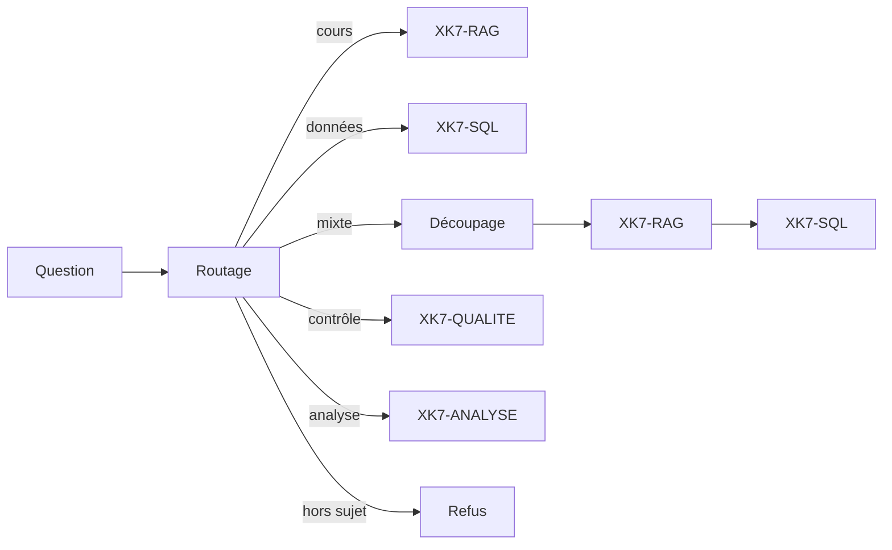
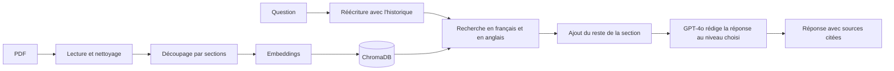

# XK7

Un assistant data multi-agent, déployé en ligne. Chaque agent est spécialisé, et tous partagent les mêmes principes : réponses vérifiables, refus plutôt qu'invention, sécurité et confidentialité des données.

| Agent | Rôle | État |
|---|---|---|
| XK7-RAG | Répond aux questions sur les bases de données et le SQL à partir d'une bibliothèque d'ouvrages, en citant ses sources | Terminé |
| XK7-SQL | Interroge une base de données en français : écrit la requête SQL, l'exécute en lecture seule et affiche le résultat, sans jamais montrer les données au modèle. Pour une modification, propose la requête sans l'exécuter | Terminé |
| XK7-ANALYSE | Analyse une base (évolution, répartition, comparaison, classement, corrélation) et trace le graphique ; calculs et conclusion faits par le code, sans montrer les données au modèle | Terminé |
| XK7-QUALITE | Contrôle la qualité des données (doublons, valeurs manquantes, formats, liens cassés, règles métier) et propose un script de correction, sans jamais l'exécuter | Terminé |
| XK7-CORE | Agent chef (LangGraph) qui envoie chaque question au bon agent, ou découpe une question mixte et enchaîne les deux | Terminé |

## Démo en ligne

L'application est déployée sur Streamlit Community Cloud : https://xk7-rag.streamlit.app (XK7-CORE choisit l'agent automatiquement ; chaque agent reste accessible seul)

L'accès est protégé par un mot de passe (chaque question appelle l'API OpenAI, donc a un coût). Il est disponible sur demande.

## Pourquoi ce projet

- Monter en compétence sur les technologies d'IA générative les plus demandées : RAG, embeddings, bases vectorielles, LLM, évaluation, et bientôt les systèmes multi-agents.
- Répondre à un besoin réel : retrouver vite une information fiable dans une documentation longue, sans relire des centaines de pages, et pouvoir vérifier la source.
- Construire une brique réutilisable pour la suite du projet.

## XK7-CORE : le chef d'orchestre

XK7-CORE lit la question et décide qui doit répondre : XK7-RAG pour une question de cours ("C'est quoi une jointure externe ?"), XK7-SQL pour une question sur les données ("Quel genre musical se vend le mieux ?"), XK7-QUALITE pour un contrôle ("Vérifie la qualité des données", "Regarde mon fichier"), XK7-ANALYSE pour une analyse avec graphique ("Comment évolue le chiffre d'affaires par mois ?"), les deux pour une question mixte ("Explique le GROUP BY, puis donne le chiffre d'affaires par pays"), ou personne pour une question hors sujet.

Il est construit avec LangGraph, sous forme de graphe d'étapes :



- Le routage utilise GPT-4o-mini (environ 1 seconde par décision). Il renvoie l'agent choisi, une raison, et la question réécrite pour être comprise seule ("Et ceux qui ont dépensé moins ?" devient "Trouve les clients qui ont dépensé moins que la moyenne"), car XK7-SQL n'a pas de mémoire de la conversation.
- Une question mixte est découpée en une question de cours et une question sur les données, envoyées chacune à son agent. Les deux réponses sont affichées l'une sous l'autre, sans être fusionnées par un modèle : le résultat de XK7-SQL n'est jamais montré à une IA.
- Le routeur ne voit que la question, les questions précédentes, les noms des tables et le nom du fichier déposé. Jamais les réponses ni les données.
- L'interface affiche le choix du chef, sa raison, la question comprise et le découpage, pour que chaque décision soit vérifiable.
- Fichiers : `router.py` (routage et réécriture), `core.py` (graphe LangGraph et découpage), `eval_router_questions.py` et `evaluate_router.py` (évaluation).

### Évaluation du routage

61 questions : cours, données, contrôles de qualité, analyses, questions mixtes, hors sujet, questions de suivi, demandes vagues sur un fichier déposé, et des pièges ("Combien de types de jointures existe-t-il ?" est une question de cours malgré le "combien" ; "Quel est le chiffre d'affaires par pays ?" reste une question pour XK7-SQL malgré le "par pays").

| Mesure | Résultat |
|---|---|
| Premier essai (28 questions) | 26/28 |
| Après correction du prompt (34 questions) | 34/34 |
| Après ajout de XK7-QUALITE et des fichiers déposés (47 questions) | 47/47 (14 cours, 15 données, 10 qualité, 4 mixtes, 4 hors sujet) |
| Après ajout de XK7-ANALYSE (57 questions, premier essai) | 54/57 : 2 questions sur les données envoyées à l'analyse, 1 régression |
| Après correction du prompt (61 questions) | 61/61 (16 cours, 18 données, 10 qualité, 9 analyse, 4 mixtes, 4 hors sujet) |
| Avec les questions « doit répondre » (64 questions) | 64/64 |
| Dont questions écrites après les corrections | 10/10 |
| Temps moyen par décision | environ 1 s |

Après chaque correction, de nouvelles questions sont écrites, pour vérifier que les nouvelles règles marchent en général et pas seulement sur les questions qui les ont fait naître (éviter le surapprentissage du prompt).

### Ce que les tests de bout en bout ont révélé

1. "Isolation faible" envoyée en hors sujet : sans contexte, le petit modèle ne reconnaissait pas le terme. Correction : sujets du RAG listés précisément, et règle de prudence (entre cours et hors sujet, choisir le cours : le RAG dira lui-même s'il ne trouve rien).
2. Partie données d'une question mixte refusée : le modèle de découpage écrivait la clé "données" avec un accent au lieu de "donnees", le découpage échouait en silence. Correction : lecture tolérante des réponses du modèle, et découpage affiché dans l'interface.
3. Le modèle de découpage répondait à la question de cours au lieu de la recopier. Correction : consigne avec un exemple, et garde-fou dans le code qui rejette une partie plus longue que la question entière.
4. Question de suivi refusée par XK7-SQL, qui n'a pas d'historique. Correction : le routeur réécrit la question pour qu'elle soit autonome.
5. "Clients qui ont dépensé plus que la moyenne" : un lancement comparait le total de chaque client à la moyenne d'une facture, et renvoyait les 59 clients. Correction : règle sur le niveau d'agrégation dans le prompt de XK7-SQL, et question ajoutée à son évaluation.

6. Ajout de XK7-ANALYSE : "Donne la durée moyenne des morceaux par genre" et "Quel genre se vend le mieux en France ?" partaient à l'analyse (le "par genre" suffisait à évoquer une répartition), et "l'isolation faible" retombait en hors sujet : le prompt plus long faisait oublier une règle au petit modèle. Correction : l'analyse exige un mot explicite (évolution, répartition, part, compare, lien, graphique...), et les notions internes des SGBD sont toujours du cours. Ajouter un agent modifie le comportement des autres : on relance toute l'évaluation, pas seulement les nouvelles questions.

Leçon commune : chaque appel à un modèle est un point où le système peut dérailler, même pour une tâche simple comme découper une phrase. Les réponses des modèles sont donc toujours vérifiées par le code.

## XK7-ANALYSE : l'analyse avec graphique

XK7-ANALYSE répond aux questions d'analyse ("Comment évolue le chiffre d'affaires par mois ?", "Quelle est la répartition des clients par ville ?", "Y a-t-il un lien entre la durée d'un morceau et sa taille ?") par un graphique, un tableau et une conclusion chiffrée.

### Le partage des rôles

| Étape | Fait par | Détail |
|---|---|---|
| Choisir l'analyse | GPT-4o, à partir de la structure seule | Type (évolution, comparaison, classement, répartition, corrélation), colonnes, agrégation, période, et une requête SQL qui extrait les lignes de détail (sans GROUP BY) |
| Extraire | le code | Même exécution que XK7-SQL : lecture seule, requête unique, limite de temps |
| Calculer | pandas, en local | Regroupement par période ou catégorie, parts, histogramme, coefficient de corrélation (Pearson et rang) |
| Conclure | le code | Phrases écrites à partir des chiffres : "Thé représente 35,1 % du total", "r = 0,96, liaison très forte et positive" |
| Tracer | Altair dans Streamlit | Courbe sur un vrai axe de dates, barres dans l'ordre calculé, nuage de points |

Le modèle n'écrit jamais la conclusion : il ne voit pas les chiffres, donc il ne peut ni les inventer ni les faire fuiter. La conclusion signale aussi les pièges de lecture : dernière période incomplète, moyenne tirée par quelques valeurs extrêmes, catégorie qui écrase les autres, et le rappel qu'une corrélation ne prouve pas une cause.

### Robustesse

- Un plan qui échoue (colonne absente, texte au lieu de nombres, requête invalide) est renvoyé au modèle avec l'erreur, deux corrections au maximum. Les messages d'erreur ne contiennent jamais de valeur de données.
- Les petites maladresses fréquentes (colonne rangée en y au lieu de x, agrégation inconnue) sont réparées par le code au lieu de coûter un essai.
- Une demande de modification est refusée, comme dans XK7-SQL.

### Évaluation

18 questions (12 sur Chinook, 6 sur un fichier de ventes déposé), chacune comparée à une requête SQL de référence : première ligne du résultat (étiquette et valeur, 1 % de tolérance), nombre de lignes des classements, coefficient de corrélation.

| Mesure | Résultat |
|---|---|
| Premier essai | 17/18 (un histogramme en échec après 3 essais) |
| Après normalisation des plans | 18/18, toutes du premier coup |
| Données envoyées au modèle | aucune (noms, emails, prix et montants recherchés dans tous les prompts) |

Fichiers : `analyse_agent.py`, `eval_analyse_questions.py`, `evaluate_analyse.py`.

## XK7-QUALITE : le contrôle des données

XK7-QUALITE contrôle une base (Chinook ou un fichier déposé) et rend un rapport avec un score par table, des exemples et un script de correction.

### Ce qu'il contrôle

| Contrôle | Exemple | Fait par |
|---|---|---|
| Valeurs manquantes | quelques emails vides dans une colonne presque toujours remplie | le code |
| Doublons exacts | une commande saisie deux fois | le code |
| Doublons approchés | "Élodie Martin" et "ELODIE MARTIN " | le code |
| Formats | email invalide, code postal "750O1", "Lyon" / "LYON", espaces en trop | le code |
| Valeurs aberrantes | quantité de -2, salaire mensuel de 48 000 € | le code |
| Liens cassés | une commande d'un client qui n'existe pas | le code |
| Règles métier | une commande avant l'inscription du client, une absence qui finit avant de commencer | GPT-4o, à partir de la structure seule |

- Les contrôles sont faits en local, en environ une seconde, sans IA. L'agent devine seul les identifiants et les liens, même dans un Excel qui n'en déclare aucun.
- Trois gravités : erreur, à vérifier, info (une colonne vide à 80 % est sans doute facultative).
- Les règles métier sont écrites en SQL par GPT-4o à partir de la structure, puis passent par les barrières de sécurité de XK7-SQL. Une requête défaillante est réparée automatiquement (commentaires, apostrophes) ou renvoyée une fois au modèle avec le message d'erreur.

### Les corrections : XK7 propose, l'humain décide

Pour chaque problème, un conseil et, quand c'est sûr et mécanique, une instruction SQL (TRIM des espaces, harmonisation des écritures, suppression des doublons exacts). Le tout forme un script téléchargeable, dans une transaction annulable (BEGIN / COMMIT / ROLLBACK). Ce qui demande un jugement humain (fusionner deux fiches, corriger un salaire) reste en commentaire avec la requête pour retrouver les lignes. Le script est écrit par le code, et XK7 ne l'exécute jamais.

### Évaluation

Une boutique fictive en deux versions : une propre, et une copie avec 21 erreurs injectées volontairement (`make_quality_test.py`, `evaluate_quality.py`).

| Mesure | Résultat |
|---|---|
| Erreurs retrouvées par les contrôles locaux | 19/21 (les 2 autres sont des règles métier) |
| Erreurs retrouvées avec les règles métier de GPT-4o | 21/21 attendues (voir `evaluate_quality.py`) |
| Fausses alertes sur la version propre | 0 |
| Données envoyées au modèle | aucune |

Test supplémentaire sur un fichier RH fictif jamais vu pendant le développement : les 15 erreurs cachées retrouvées, dont les 2 règles métier, pensées seules par le modèle. Sur Chinook, l'agent trouve de vrais défauts de cette base très connue : "Edinburgh " avec un espace en trop, "Dublin" dans la colonne des États, des playlists en double. Sur le fichier de test de XK7-SQL, il a trouvé 10 commandes passées avant l'inscription du client, une erreur réelle dans la génération de ce fichier.

## XK7-RAG : la documentation

XK7-RAG s'appuie sur quatre documents (un cours de SQL, un manuel de conception de bases de données, la documentation officielle de PostgreSQL 18 et un recueil de recherche, plus de 1 300 pages au total). Il retrouve les passages utiles, puis GPT-4o rédige une réponse en français uniquement à partir de ces passages, avec le document et la page de chaque information. Si la réponse n'est pas dans les documents, il le dit au lieu d'inventer.

### Pourquoi pas simplement ChatGPT ou Claude ?

Un assistant généraliste répond avec ce qu'il a appris pendant son entraînement. Un RAG répond avec vos documents. Concrètement :

- Des réponses vérifiables : chaque information est accompagnée du document et de la page, on peut aller vérifier.
- Moins d'inventions : l'assistant n'a le droit de répondre qu'à partir des passages retrouvés, et refuse quand l'information n'y est pas.
- Les connaissances propres à l'entreprise : procédures internes, documentation d'un logiciel maison, référentiels de données. Un modèle généraliste ne les connaît pas.
- Des documents à jour : il suffit de réindexer un document pour que l'assistant en tienne compte, sans réentraîner de modèle.
- Le contrôle des données : on choisit exactement quels documents sont consultés, ce qui facilite la gestion des droits et de la confidentialité. Le modèle peut ensuite être remplacé par un modèle hébergé en interne si les documents sont sensibles.
- Un coût maîtrisé : on n'envoie au modèle que quelques passages, pas des documents entiers.
- Une brique réutilisable : le même moteur peut servir dans une application web, une API ou un système multi-agent.

### Ce qu'il fait

- Répond en français, même quand la source est en anglais.
- Cite ses sources sous la forme (Titre du document, p. X) et n'affiche sous la réponse que les passages réellement cités.
- Refuse de répondre quand l'information n'est pas dans les documents, et donne une réponse partielle en précisant ce qui manque quand c'est le cas.
- Adapte sa façon d'expliquer à trois niveaux : Débutant (avec des images de la vie courante), Intermédiaire et Expert (définitions formelles et cas limites). Le contenu reste le même, seule la manière d'expliquer change.
- Garde le fil de la conversation : une question de suivi comme "et pour rollback ?" est réécrite pour être comprise seule.
- Ne recopie que du code SQL présent dans les documents, sans en inventer.

### Corpus

| Document | Auteurs | Licence | Contenu |
|---|---|---|---|
| Cours SQL | Cours universitaire public | Cours public | Modèle relationnel, SQL de base à avancé (142 pages) |
| Database Design, 2nd Edition | Adrienne Watt, Nelson Eng | CC BY 4.0 | Conception, modélisation, normalisation |
| PostgreSQL 18 Documentation | The PostgreSQL Global Development Group | Licence PostgreSQL | Parties Tutorial, The SQL Language et SQL Commands uniquement |
| Readings in Database Systems, 5th Edition (Red Book) | Peter Bailis, Joseph M. Hellerstein, Michael Stonebraker | CC BY-NC-ND | Recherche : transactions, isolation, architecture des SGBD |

Les documents ne sont pas versionnés dans le dépôt. Le Red Book est sous licence non commerciale : le projet est un projet personnel, gratuit et non commercial.

### Fonctionnement



| Étape | Fichier | Détail |
|---|---|---|
| Lecture et nettoyage | `loader.py` | Extraction du texte avec pypdf, correction des défauts des PDF (ligatures, petites majuscules, mots coupés, en-têtes et numéros de page), retrait des pages de sommaire |
| Découpage | `loader.py` | Découpage selon les sections du document grâce aux signets du PDF, sous-sections numérotées comprises. Chaque morceau commence par le chemin de sa section (ex. PostgreSQL 18 > 11. Indexes > 11.8. Partial Indexes) |
| Indexation | `vectorstore.py` | Embeddings OpenAI text-embedding-3-small, stockés dans ChromaDB (3 803 morceaux) |
| Recherche | `rag.py` | La question est cherchée en français et traduite en anglais, les résultats des deux recherches sont alternés |
| Contexte | `rag.py` | Chaque passage trouvé est complété par le reste de sa section, comme un lecteur qui lit toute la section après avoir trouvé le bon paragraphe |
| Réponse | `rag.py` | GPT-4o (température 0) répond uniquement à partir des passages, au niveau choisi, en citant ses sources |
| Interface | `app.py` | Application Streamlit commune aux agents : conversation, choix de l'agent, niveau, nombre de passages, sources citées, mot de passe et limite de questions |
| Évaluation | `evaluate.py`, `eval_questions.py` | 18 questions de test, mesure de la recherche et de la justesse des réponses |
| Thème | `.streamlit/config.toml` | Thème sombre de l'interface |

## XK7-SQL : les données

XK7-SQL répond en français à des questions sur une base de données : "Quels sont les 5 clients qui ont le plus dépensé ?", "Quels clients n'ont jamais acheté de jazz ?". Il écrit la requête SQL, l'exécute, puis affiche le résultat en tableau avec la requête utilisée et un export CSV.

La base de démonstration est Chinook (une boutique de musique en ligne : 11 tables, clients, factures, morceaux). L'utilisateur peut aussi déposer son propre fichier : CSV, Excel (un onglet = une table) ou base SQLite.

### Confidentialité : le modèle ne voit jamais les données

C'est le principe central de XK7-SQL. Le modèle reçoit uniquement la structure de la base : noms des tables et des colonnes, types, clés primaires et liens entre tables. Il écrit la requête à l'aveugle, la requête s'exécute localement, et le résultat est affiché sans repasser par le modèle.

- Aucune ligne de données n'est envoyée, ni en exemple, ni dans les résultats.
- En cas d'erreur, seul le message SQL (qui ne décrit que la structure) est renvoyé au modèle pour qu'il corrige.
- Un fichier déposé est converti en base temporaire, supprimée au changement de fichier ou au bout d'une heure.
- Un test automatique le prouve : il cherche toutes les valeurs texte de la base dans ce qui a été envoyé au modèle, et n'en trouve aucune. Le même test détecte bien les fuites quand on réactive volontairement les lignes d'exemple.
- Le code est prêt pour un mode 100 % local : le fournisseur du modèle se choisit dans `.env` (OpenAI ou Ollama), pour qu'aucune information, même la structure, ne quitte la machine.

### Sécurité : trois barrières indépendantes

1. Le prompt interdit au modèle d'exécuter une modification ("supprime", "mets à jour"...) : il peut seulement la proposer (voir plus bas).
2. Avant l'exécution, `check_sql()` n'accepte qu'une seule requête de lecture (SELECT ou WITH) et refuse les mots-clés dangereux (DELETE, DROP, UPDATE, PRAGMA, ATTACH...), y compris les contournements comme `WITH ... DELETE` ou deux requêtes séparées par un point-virgule.
3. La base est ouverte en lecture seule : même une requête qui passerait les deux premières barrières ne pourrait rien modifier.

S'y ajoutent une limite de 5 secondes par requête et de 100 lignes par résultat.

### Les modifications : proposer sans exécuter

Une première version refusait sèchement toute demande de modification, même "Quel code SQL pour supprimer les ventes inférieures à 30 en août ?", où l'utilisateur voulait seulement le code. Un assistant qui refuse trop souvent n'est pas utilisé : XK7-SQL propose désormais la requête, sans jamais l'exécuter.

- La requête proposée est vérifiée par SQLite avec `EXPLAIN`, qui la compile (tables et colonnes) sans la lancer, sur une base de toute façon en lecture seule. Une seule requête UPDATE, DELETE ou INSERT est acceptée.
- L'aperçu des lignes concernées est calculé par le code à partir de la requête proposée : `UPDATE t SET ... WHERE c` devient `SELECT * FROM t WHERE c`. Le modèle écrivait parfois un aperçu des lignes après modification ("les prix déjà à 0") : un aperçu construit par le code reprend exactement les mêmes conditions.
- Un aperçu vide déclenche une vérification : sur "en août", le modèle avait inventé une année ; il corrige et trouve les 9 commandes concernées.
- L'évaluation vérifie que la requête est proposée et que l'aperçu montre le bon nombre de lignes.

### Fonctionnement

| Étape | Fichier | Détail |
|---|---|---|
| Structure | `sql_schema.py` | Lecture des tables, colonnes, clés et liens (`PRAGMA`), résumés en un texte d'environ 2 000 caractères, sans aucune donnée |
| Requête | `sql_agent.py` | GPT-4o écrit la requête SQLite à partir de la question et de la structure, avec une phrase d'explication, ou refuse (hors sujet ou modification) |
| Sécurité | `sql_agent.py` | Vérification de la requête, exécution en lecture seule avec limites de temps et de lignes |
| Auto-correction | `sql_agent.py` | Si la requête échoue, le message d'erreur est renvoyé au modèle, qui corrige (3 essais au maximum) |
| Fichiers | `data_upload.py` | Conversion d'un CSV, d'un Excel ou d'une base SQLite déposés en base temporaire (séparateur détecté, nombres à la française convertis) |
| Évaluation | `evaluate_sql.py`, `eval_sql_questions.py` | 31 questions, résultats comparés à des requêtes de référence, aperçu des modifications vérifié, test de confidentialité |

### Évaluation

Le jeu de test compte 31 questions sur deux bases :

- Chinook (20 questions) : 3 simples, 7 moyennes (classements, regroupements, filtres sur les dates), 5 difficiles (NOT IN, NOT EXISTS, table jointe à elle-même), 3 demandes de modification et 2 questions hors sujet.
- Une base inconnue (11 questions, dont une demande de modification) : un fichier Excel fictif (`data/ventes_cafe_test.xlsx`, une boutique de café et de thé) que le modèle n'a jamais pu voir. Il n'a aucun lien déclaré entre les onglets, des noms de colonnes en français avec espaces et accents, et un chiffre d'affaires à calculer (quantité × prix unitaire).

L'évaluation compare les résultats, pas les requêtes : deux requêtes différentes qui donnent le même résultat sont toutes les deux justes. L'agent peut ajouter des colonnes ou présenter un nom en une seule colonne ; l'ordre ne compte que pour les classements.

| Mesure | Résultat |
|---|---|
| Chinook : résultats justes | 15/15 |
| Chinook : modifications proposées avec le bon aperçu, et refus hors sujet | 5/5 |
| Base inconnue : résultats justes et modification proposée | 11/11 |
| Données de la base envoyées au modèle | aucune |

Sur Chinook, les résultats sont identiques avec et sans lignes d'exemple dans le prompt.

### Ce que la base inconnue a révélé

Les premiers tests sur le fichier Excel ont fait apparaître deux erreurs que Chinook cachait, sur la question "Combien de clients n'ont jamais acheté de thé ?" (bonne réponse : 3).

1. Réponse 30. Le prompt disait que les valeurs étaient "probablement en anglais", ce qui était vrai pour Chinook. Le modèle a filtré sur 'Tea', une valeur qui n'existe pas, et la requête a donné un résultat faux sans aucune erreur. Correction : la langue des valeurs est déduite de celle des colonnes, et surtout une vérification locale contrôle que chaque valeur utilisée comme filtre existe dans la base. Si ce n'est pas le cas, le modèle est prévenu ("'Tea' n'existe dans aucune colonne") et corrige. Seule sa propre valeur inventée lui est renvoyée, jamais une vraie donnée. Si la valeur reste introuvable, l'interface affiche un avertissement.
2. Réponse 29. Le modèle a compté les clients ayant acheté au moins un produit qui n'est pas du thé, au lieu d'exclure ceux qui en ont acheté au moins une fois (le piège classique de la double négation), et il a filtré sur le nom des produits plutôt que sur leur catégorie. Correction : deux règles dans le prompt (NOT EXISTS ou NOT IN pour "jamais" ou "aucun", et filtrer de préférence sur une colonne de catégorie), écrites avec des exemples génériques pour ne pas souffler la réponse du test.

Après ces corrections : 9/9 sur la base inconnue, sans régression sur Chinook.

### Limites

- Chinook est une base très connue, que le modèle a probablement vue pendant son entraînement. C'est pour cela qu'une base inconnue a été ajoutée au jeu de test. Elle reste petite et ses noms de colonnes sont clairs : une vraie base d'entreprise (centaines de tables, noms abrégés) serait plus difficile.
- Les règles ajoutées après les erreurs de la base inconnue ont été testées sur les questions qui les ont révélées : il faudrait d'autres bases inconnues pour mesurer leur effet en général.
- Sans voir les données, le modèle peut se tromper sur une valeur exacte (une orthographe, une langue, un format de date). Le prompt compense par des règles (LIKE, strftime), mais pas dans tous les cas.
- Même à température 0, la requête écrite peut varier d'un lancement à l'autre. C'est pour cela que l'évaluation porte sur les résultats.
- Les questions ambiguës ("nos meilleurs clients", selon quel critère ?) ne sont pas encore testées.

## Technologies

Python 3.12, LangChain, LangGraph, OpenAI (GPT-4o, GPT-4o-mini, text-embedding-3-small), ChromaDB, SQLite, pandas, Streamlit, pypdf.

## Installation

Prérequis : Python 3.12 et une clé API OpenAI.

```bash
git clone https://github.com/Cafew-Carnaval/XK7-RAG.git
cd XK7-RAG
py -3.12 -m venv .venv
.venv\Scripts\activate          # Windows
pip install -r requirements.txt
```

Créer un fichier `.env` à la racine (il n'est jamais versionné) :

```
OPENAI_API_KEY=sk-...
APP_PASSWORD=un-mot-de-passe-dedie-au-projet
```

Placer les PDF dans le dossier `data/` avec les noms attendus par `loader.py` (`test.pdf`, `database_design.pdf`, `postgresql.pdf`, `redbook.pdf`). La base Chinook (`data/chinook.db`) est fournie dans le dépôt. Puis :

```bash
python vectorstore.py      # construit la base vectorielle
streamlit run app.py       # lance l'interface sur http://localhost:8501
python evaluate.py         # évaluation de XK7-RAG
python evaluate_sql.py     # évaluation de XK7-SQL
python evaluate_router.py  # évaluation du routage de XK7-CORE
python evaluate_quality.py # évaluation de XK7-QUALITE (crée les fichiers de test si besoin)
python evaluate_analyse.py # évaluation de XK7-ANALYSE
python analyse_agent.py    # quatre analyses de démonstration dans le terminal
python quality_agent.py data/qualite_sale.xlsx   # rapport de qualité dans le terminal
python core.py             # trois questions de démonstration dans le terminal
python sql_agent.py        # tests de sécurité et quelques questions dans le terminal
```

## Choix techniques

- Python 3.12 plutôt que la dernière version : ChromaDB et numpy n'avaient pas encore de versions compatibles avec Python 3.15.
- Nettoyage du texte avant indexation : les PDF générés avec LaTeX produisaient des caractères corrompus qui empêchaient de retrouver certains mots. Chaque correction a été vérifiée en comparant le texte extrait au PDF d'origine. Les réglages (en-tête, numéro de page, pages à lire) sont définis document par document dans un catalogue.
- Découpage par sections plutôt que par pages : le découpage par pages séparait parfois un titre de son contenu. Avec les signets du PDF, chaque morceau sait à quelle section il appartient.
- Recherche bilingue : trois documents sur quatre sont en anglais. Une question en français retrouvait mal les passages anglais (le bon passage du Red Book passait du 6e au 1er rang avec la traduction).
- Garde-fous contre les inventions : réponse uniquement à partir des extraits, pas de code SQL inventé, comparaisons pédagogiques autorisées mais jamais en contradiction avec les extraits. Ces règles ont été ajoutées après avoir observé de vraies erreurs pendant les tests.
- Base vectorielle versionnée : la base ChromaDB est poussée sur GitHub pour que l'application en ligne n'ait pas à recalculer les embeddings au démarrage.
- XK7-SQL sans accès aux données : plutôt que d'envoyer des lignes d'exemple au modèle (plus simple, un peu plus précis), seule la structure est envoyée, et le résultat ne repasse jamais par le modèle. C'est la condition pour l'utiliser sur des données d'entreprise.
- Sécurité de la démo : mot de passe dédié, nombre de questions limité par session, clés dans les secrets de Streamlit et jamais dans le code.

## Évaluation de XK7-RAG

Le jeu de test compte 18 questions : 9 sur le cours SQL (3 simples, 3 moyennes, 3 difficiles), 2 sur Database Design, 2 de niveau expert sur le Red Book, 4 sur PostgreSQL 18 et 1 question hors corpus à laquelle l'agent doit refuser de répondre.

Le script `evaluate.py` mesure trois choses :

- La recherche : à quel rang arrive le premier bon passage (bon document et bonne page).
- La réponse : l'agent répond-il, et refuse-t-il bien la question hors corpus ?
- La justesse : chaque question a 2 ou 3 points clés attendus (par exemple, pour la division en SQL : la double négation avec not exists, la méthode par comptage, l'exemple des membres inscrits à toutes les activités). GPT-4o-mini joue le rôle de correcteur et vérifie la présence de chaque point dans la réponse.

Évolution des résultats au fil du projet :

| Étape | Questions | L'agent répond | Refus hors corpus |
|---|---|---|---|
| Découpage par pages | 9 | 6/9 | oui |
| Découpage par sections | 9 | 8/9 | oui |
| Prompt pédagogique et sections complètes | 9 | 9/9 | oui |
| Corpus de 3 documents, recherche bilingue | 12 | 12/12 | oui |
| Ajout de PostgreSQL 18 (3 803 morceaux) | 17 | 17/17 | oui |

Résultats détaillés de la dernière version (17 questions dans le corpus, 1 hors corpus) :

| Mesure | Résultat |
|---|---|
| Bon passage dans les 3 premiers résultats | 15/17 |
| Bon passage dans les 10 premiers résultats | 16/17 |
| L'agent répond | 17/17 |
| Refus de la question hors corpus | oui |
| Points clés présents dans les réponses | 43/45 |
| Réponses complètes (tous les points clés) | 15/17 |

Les deux points manquants sont des oublis, pas des erreurs : la réponse sur les jointures externes ne précise pas que la condition s'écrit avec on ou using, et la réponse sur l'isolation faible ne mentionne pas l'exemple du retrait bancaire en double.

## Limites de XK7-RAG

- Le correcteur automatique est lui-même un modèle de langage : il peut se tromper, et les points clés ne couvrent pas toute la qualité d'une réponse (clarté, adaptation au niveau). Une relecture humaine reste utile.
- Le jeu de test est petit (18 questions). Les résultats donnent une tendance, pas une mesure fiable à la décimale près.
- La documentation de référence de PostgreSQL est très dense : pour la question sur string_agg, la page attendue n'arrive pas dans les 10 premiers passages. La réponse est pourtant juste, car la fonction est aussi décrite à d'autres endroits de la documentation. La liste des pages attendues est sans doute trop étroite.
- Temps de réponse d'environ 20 secondes : réécriture, traduction, deux recherches et une génération avec GPT-4o s'enchaînent.
- La base vectorielle fait environ 65 Mo. Ajouter beaucoup d'autres documents demandera de la construire au déploiement ou de passer par Git LFS.

## Prochaines étapes

- XK7-ANALYSE : tendances, comparaisons et graphiques, calculés en local.
- Mode 100 % local avec Ollama, et tests de XK7-SQL sur des bases moins connues et des questions ambiguës.
- Réduire le temps de réponse (appels en parallèle, cache, modèle plus léger pour certaines étapes).
- Recherche hybride (sens et mots-clés) et reranking pour les documentations très denses.
- API avec FastAPI, conteneur Docker et suivi des appels avec LangSmith.

## Sources

- Cours universitaire public de bases de données et SQL.
- Watt, A. et Eng, N. Database Design, 2nd Edition. BCcampus, licence CC BY 4.0.
- The PostgreSQL Global Development Group. PostgreSQL 18 Documentation, licence PostgreSQL.
- Bailis, P., Hellerstein, J. M. et Stonebraker, M. Readings in Database Systems, 5th Edition, 2015, licence CC BY-NC-ND.
- Rocha, L. Chinook Database, licence MIT (github.com/lerocha/chinook-database).

## Auteur

[Cafew-Carnaval sur GitHub](https://github.com/Cafew-Carnaval)
