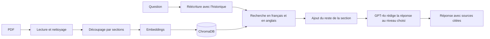

# XK7

Un assistant data multi-agent en construction. Chaque agent est spécialisé, et tous partagent les mêmes principes : réponses vérifiables, refus plutôt qu'invention, sécurité et confidentialité des données.

| Agent | Rôle | État |
|---|---|---|
| XK7-RAG | Répond aux questions sur les bases de données et le SQL à partir d'une bibliothèque d'ouvrages, en citant ses sources | Terminé |
| XK7-SQL | Interroge une base de données en français : écrit la requête SQL, l'exécute en lecture seule et affiche le résultat, sans jamais montrer les données au modèle | Terminé |
| XK7-ANALYSE | Calculs, tendances et graphiques à partir des résultats SQL | À venir |
| XK7-QUALITE | Contrôle de la qualité des données (doublons, valeurs manquantes, incohérences) | À venir |
| XK7-CORE | Agent chef (LangGraph) qui envoie chaque question au bon agent et les enchaîne | À venir |

## Démo en ligne

L'application est déployée sur Streamlit Community Cloud : https://xk7-rag.streamlit.app (XK7-RAG et XK7-SQL, au choix dans la barre latérale)

L'accès est protégé par un mot de passe (chaque question appelle l'API OpenAI, donc a un coût). Il est disponible sur demande.

## Pourquoi ce projet

- Monter en compétence sur les technologies d'IA générative les plus demandées : RAG, embeddings, bases vectorielles, LLM, évaluation, et bientôt les systèmes multi-agents.
- Répondre à un besoin réel : retrouver vite une information fiable dans une documentation longue, sans relire des centaines de pages, et pouvoir vérifier la source.
- Construire une brique réutilisable pour la suite du projet.

## XK7-RAG : la documentation

XK7-RAG s'appuie sur quatre documents (un cours de SQL, un manuel de conception de bases de données, la documentation officielle de PostgreSQL 18 et un recueil de recherche, plus de 1 300 pages au total). Il retrouve les passages utiles, puis GPT-4o rédige une réponse en français uniquement à partir de ces passages, avec le document et la page de chaque information. Si la réponse n'est pas dans les documents, il le dit au lieu d'inventer.

### Pourquoi pas simplement ChatGPT ou Claude ?

Un assistant généraliste répond avec ce qu'il a appris pendant son entraînement. Un RAG répond avec vos documents. Concrètement :

- Des réponses vérifiables : chaque information est accompagnée du document et de la page, on peut aller vérifier.
- Moins d'inventions : l'assistant n'a le droit de répondre qu'à partir des passages retrouvés, et refuse quand l'information n'y est pas.
- Les connaissances propres à l'entreprise : procédures internes, documentation d'un logiciel maison, référentiels de données. Un modèle généraliste ne les connaît pas.
- Des documents à jour : il suffit de réindexer un document pour que l'assistant en tienne compte, sans réentraîner de modèle.
- Le contrôle des données : on choisit exactement quels documents sont consultés, ce qui facilite la gestion des droits et de la confidentialité. Le modèle peut ensuite être remplacé par un modèle hébergé en interne si les documents sont sensibles.
- Un coût maîtrisé : on n'envoie au modèle que quelques passages, pas des documents entiers.
- Une brique réutilisable : le même moteur peut servir dans une application web, une API ou un système multi-agent.

### Ce qu'il fait

- Répond en français, même quand la source est en anglais.
- Cite ses sources sous la forme (Titre du document, p. X) et n'affiche sous la réponse que les passages réellement cités.
- Refuse de répondre quand l'information n'est pas dans les documents, et donne une réponse partielle en précisant ce qui manque quand c'est le cas.
- Adapte sa façon d'expliquer à trois niveaux : Débutant (grand public, avec des images de la vie courante), Intermédiaire (bac+1 à bac+5) et Expert (bac+6 et plus, définitions formelles et cas limites). Le contenu reste le même, seule la manière d'expliquer change.
- Garde le fil de la conversation : une question de suivi comme "et pour rollback ?" est réécrite pour être comprise seule.
- Ne recopie que du code SQL présent dans les documents, sans en inventer.

### Corpus

| Document | Auteurs | Licence | Contenu |
|---|---|---|---|
| Cours SQL | Cours universitaire public | Cours public | Modèle relationnel, SQL de base à avancé (142 pages) |
| Database Design, 2nd Edition | Adrienne Watt, Nelson Eng | CC BY 4.0 | Conception, modélisation, normalisation |
| PostgreSQL 18 Documentation | The PostgreSQL Global Development Group | Licence PostgreSQL | Parties Tutorial, The SQL Language et SQL Commands uniquement |
| Readings in Database Systems, 5th Edition (Red Book) | Peter Bailis, Joseph M. Hellerstein, Michael Stonebraker | CC BY-NC-ND | Recherche : transactions, isolation, architecture des SGBD |

Les documents ne sont pas versionnés dans le dépôt. Le Red Book est sous licence non commerciale : le projet est un projet personnel, gratuit et non commercial.

### Fonctionnement



| Étape | Fichier | Détail |
|---|---|---|
| Lecture et nettoyage | `loader.py` | Extraction du texte avec pypdf, correction des défauts des PDF (ligatures, petites majuscules, mots coupés, en-têtes et numéros de page), retrait des pages de sommaire |
| Découpage | `loader.py` | Découpage selon les sections du document grâce aux signets du PDF, sous-sections numérotées comprises. Chaque morceau commence par le chemin de sa section (ex. PostgreSQL 18 > 11. Indexes > 11.8. Partial Indexes) |
| Indexation | `vectorstore.py` | Embeddings OpenAI text-embedding-3-small, stockés dans ChromaDB (3 803 morceaux) |
| Recherche | `rag.py` | La question est cherchée en français et traduite en anglais, les résultats des deux recherches sont alternés |
| Contexte | `rag.py` | Chaque passage trouvé est complété par le reste de sa section, comme un lecteur qui lit toute la section après avoir trouvé le bon paragraphe |
| Réponse | `rag.py` | GPT-4o (température 0) répond uniquement à partir des passages, au niveau choisi, en citant ses sources |
| Interface | `app.py` | Application Streamlit commune aux agents : conversation, choix de l'agent, niveau, nombre de passages, sources citées, mot de passe et limite de questions |
| Évaluation | `evaluate.py`, `eval_questions.py` | 18 questions de test, mesure de la recherche et de la justesse des réponses |
| Thème | `.streamlit/config.toml` | Thème sombre de l'interface |

## XK7-SQL : les données

XK7-SQL répond en français à des questions sur une base de données : "Quels sont les 5 clients qui ont le plus dépensé ?", "Quels clients n'ont jamais acheté de jazz ?". Il écrit la requête SQL, l'exécute, puis affiche le résultat en tableau avec la requête utilisée et un export CSV.

La base de démonstration est Chinook (une boutique de musique en ligne : 11 tables, clients, factures, morceaux). L'utilisateur peut aussi déposer son propre fichier : CSV, Excel (un onglet = une table) ou base SQLite.

### Confidentialité : le modèle ne voit jamais les données

C'est le principe central de XK7-SQL. Le modèle reçoit uniquement la structure de la base : noms des tables et des colonnes, types, clés primaires et liens entre tables. Il écrit la requête à l'aveugle, la requête s'exécute localement, et le résultat est affiché sans repasser par le modèle.

- Aucune ligne de données n'est envoyée, ni en exemple, ni dans les résultats.
- En cas d'erreur, seul le message SQL (qui ne décrit que la structure) est renvoyé au modèle pour qu'il corrige.
- Un fichier déposé est converti en base temporaire, supprimée au changement de fichier ou au bout d'une heure.
- Un test automatique le prouve : il cherche toutes les valeurs texte de la base dans ce qui a été envoyé au modèle, et n'en trouve aucune. Le même test détecte bien les fuites quand on réactive volontairement les lignes d'exemple.
- Le code est prêt pour un mode 100 % local : le fournisseur du modèle se choisit dans `.env` (OpenAI ou Ollama), pour qu'aucune information, même la structure, ne quitte la machine.

### Sécurité : trois barrières indépendantes

1. Le prompt demande au modèle de refuser toute demande de modification ("supprime", "mets à jour"...).
2. Avant l'exécution, `check_sql()` n'accepte qu'une seule requête de lecture (SELECT ou WITH) et refuse les mots-clés dangereux (DELETE, DROP, UPDATE, PRAGMA, ATTACH...), y compris les contournements comme `WITH ... DELETE` ou deux requêtes séparées par un point-virgule.
3. La base est ouverte en lecture seule : même une requête qui passerait les deux premières barrières ne pourrait rien modifier.

S'y ajoutent une limite de 5 secondes par requête et de 100 lignes par résultat.

### Fonctionnement

| Étape | Fichier | Détail |
|---|---|---|
| Structure | `sql_schema.py` | Lecture des tables, colonnes, clés et liens (`PRAGMA`), résumés en un texte d'environ 2 000 caractères, sans aucune donnée |
| Requête | `sql_agent.py` | GPT-4o écrit la requête SQLite à partir de la question et de la structure, avec une phrase d'explication, ou refuse (hors sujet ou modification) |
| Sécurité | `sql_agent.py` | Vérification de la requête, exécution en lecture seule avec limites de temps et de lignes |
| Auto-correction | `sql_agent.py` | Si la requête échoue, le message d'erreur est renvoyé au modèle, qui corrige (3 essais au maximum) |
| Fichiers | `data_upload.py` | Conversion d'un CSV, d'un Excel ou d'une base SQLite déposés en base temporaire (séparateur détecté, nombres à la française convertis) |
| Évaluation | `evaluate_sql.py`, `eval_sql_questions.py` | 17 questions, résultats comparés à des requêtes de référence, test de confidentialité |

### Évaluation

Le jeu de test compte 17 questions : 3 simples, 6 moyennes (classements, regroupements, filtres sur les dates), 4 difficiles (NOT IN, NOT EXISTS, table jointe à elle-même), 2 demandes de modification et 2 questions hors sujet.

L'évaluation compare les résultats, pas les requêtes : deux requêtes différentes qui donnent le même résultat sont toutes les deux justes. L'agent peut ajouter des colonnes ou présenter un nom en une seule colonne ; l'ordre ne compte que pour les classements.

| Mesure | Résultat |
|---|---|
| Résultats justes | 13/13 |
| Refus corrects (2 modifications, 2 hors sujet) | 4/4 |
| Données de la base envoyées au modèle | aucune |

Les résultats sont identiques avec et sans lignes d'exemple dans le prompt : sur ce jeu de test, le mode confidentiel ne coûte rien en qualité.

### Limites

- Chinook est une base très connue, utilisée dans de nombreux tutoriels : le modèle l'a probablement vue pendant son entraînement, ce qui l'aide à deviner des valeurs comme 'Rock' sans voir les données. Sur une base d'entreprise inconnue, aux noms de colonnes moins explicites, le score serait sans doute plus bas.
- Sans voir les données, le modèle peut se tromper sur une valeur exacte (une orthographe, une langue, un format de date). Le prompt compense par des règles (LIKE, strftime), mais pas dans tous les cas.
- Même à température 0, la requête écrite peut varier d'un lancement à l'autre. C'est pour cela que l'évaluation porte sur les résultats.
- Les questions ambiguës ("nos meilleurs clients", selon quel critère ?) ne sont pas encore testées.

## Technologies

Python 3.12, LangChain, OpenAI (GPT-4o, GPT-4o-mini, text-embedding-3-small), ChromaDB, SQLite, pandas, Streamlit, pypdf.

## Installation

Prérequis : Python 3.12 et une clé API OpenAI.

```bash
git clone https://github.com/Cafew-Carnaval/XK7-RAG.git
cd XK7-RAG
py -3.12 -m venv .venv
.venv\Scripts\activate          # Windows
pip install -r requirements.txt
```

Créer un fichier `.env` à la racine (il n'est jamais versionné) :

```
OPENAI_API_KEY=sk-...
APP_PASSWORD=un-mot-de-passe-dedie-au-projet
```

Placer les PDF dans le dossier `data/` avec les noms attendus par `loader.py` (`test.pdf`, `database_design.pdf`, `postgresql.pdf`, `redbook.pdf`). La base Chinook (`data/chinook.db`) est fournie dans le dépôt. Puis :

```bash
python vectorstore.py      # construit la base vectorielle
streamlit run app.py       # lance l'interface sur http://localhost:8501
python evaluate.py         # évaluation de XK7-RAG
python evaluate_sql.py     # évaluation de XK7-SQL
python sql_agent.py        # tests de sécurité et quelques questions dans le terminal
```

## Choix techniques

- Python 3.12 plutôt que la dernière version : ChromaDB et numpy n'avaient pas encore de versions compatibles avec Python 3.15.
- Nettoyage du texte avant indexation : les PDF générés avec LaTeX produisaient des caractères corrompus qui empêchaient de retrouver certains mots. Chaque correction a été vérifiée en comparant le texte extrait au PDF d'origine. Les réglages (en-tête, numéro de page, pages à lire) sont définis document par document dans un catalogue.
- Découpage par sections plutôt que par pages : le découpage par pages séparait parfois un titre de son contenu. Avec les signets du PDF, chaque morceau sait à quelle section il appartient.
- Recherche bilingue : trois documents sur quatre sont en anglais. Une question en français retrouvait mal les passages anglais (le bon passage du Red Book passait du 6e au 1er rang avec la traduction).
- Garde-fous contre les inventions : réponse uniquement à partir des extraits, pas de code SQL inventé, comparaisons pédagogiques autorisées mais jamais en contradiction avec les extraits. Ces règles ont été ajoutées après avoir observé de vraies erreurs pendant les tests.
- Base vectorielle versionnée : la base ChromaDB est poussée sur GitHub pour que l'application en ligne n'ait pas à recalculer les embeddings au démarrage.
- XK7-SQL sans accès aux données : plutôt que d'envoyer des lignes d'exemple au modèle (plus simple, un peu plus précis), seule la structure est envoyée, et le résultat ne repasse jamais par le modèle. C'est la condition pour l'utiliser sur des données d'entreprise.
- Sécurité de la démo : mot de passe dédié, nombre de questions limité par session, clés dans les secrets de Streamlit et jamais dans le code.

## Évaluation de XK7-RAG

Le jeu de test compte 18 questions : 9 sur le cours SQL (3 simples, 3 moyennes, 3 difficiles), 2 sur Database Design, 2 de niveau expert sur le Red Book, 4 sur PostgreSQL 18 et 1 question hors corpus à laquelle l'agent doit refuser de répondre.

Le script `evaluate.py` mesure trois choses :

- La recherche : à quel rang arrive le premier bon passage (bon document et bonne page).
- La réponse : l'agent répond-il, et refuse-t-il bien la question hors corpus ?
- La justesse : chaque question a 2 ou 3 points clés attendus (par exemple, pour la division en SQL : la double négation avec not exists, la méthode par comptage, l'exemple des membres inscrits à toutes les activités). GPT-4o-mini joue le rôle de correcteur et vérifie la présence de chaque point dans la réponse.

Évolution des résultats au fil du projet :

| Étape | Questions | L'agent répond | Refus hors corpus |
|---|---|---|---|
| Découpage par pages | 9 | 6/9 | oui |
| Découpage par sections | 9 | 8/9 | oui |
| Prompt pédagogique et sections complètes | 9 | 9/9 | oui |
| Corpus de 3 documents, recherche bilingue | 12 | 12/12 | oui |
| Ajout de PostgreSQL 18 (3 803 morceaux) | 17 | 17/17 | oui |

Résultats détaillés de la dernière version (17 questions dans le corpus, 1 hors corpus) :

| Mesure | Résultat |
|---|---|
| Bon passage dans les 3 premiers résultats | 15/17 |
| Bon passage dans les 10 premiers résultats | 16/17 |
| L'agent répond | 17/17 |
| Refus de la question hors corpus | oui |
| Points clés présents dans les réponses | 43/45 |
| Réponses complètes (tous les points clés) | 15/17 |

Les deux points manquants sont des oublis, pas des erreurs : la réponse sur les jointures externes ne précise pas que la condition s'écrit avec on ou using, et la réponse sur l'isolation faible ne mentionne pas l'exemple du retrait bancaire en double.

## Limites de XK7-RAG

- Le correcteur automatique est lui-même un modèle de langage : il peut se tromper, et les points clés ne couvrent pas toute la qualité d'une réponse (clarté, adaptation au niveau). Une relecture humaine reste utile.
- Le jeu de test est petit (18 questions). Les résultats donnent une tendance, pas une mesure fiable à la décimale près.
- La documentation de référence de PostgreSQL est très dense : pour la question sur string_agg, la page attendue n'arrive pas dans les 10 premiers passages. La réponse est pourtant juste, car la fonction est aussi décrite à d'autres endroits de la documentation. La liste des pages attendues est sans doute trop étroite.
- Temps de réponse d'environ 20 secondes : réécriture, traduction, deux recherches et une génération avec GPT-4o s'enchaînent.
- La base vectorielle fait environ 65 Mo. Ajouter beaucoup d'autres documents demandera de la construire au déploiement ou de passer par Git LFS.

## Prochaines étapes

- XK7-CORE : un agent chef avec LangGraph, qui envoie chaque question à XK7-RAG ou XK7-SQL et sait les enchaîner.
- XK7-ANALYSE et XK7-QUALITE.
- Mode 100 % local avec Ollama, et tests de XK7-SQL sur des bases moins connues et des questions ambiguës.
- Réduire le temps de réponse (appels en parallèle, cache, modèle plus léger pour certaines étapes).
- Recherche hybride (sens et mots-clés) et reranking pour les documentations très denses.
- API avec FastAPI, conteneur Docker et suivi des appels avec LangSmith.

## Sources

- Cours universitaire public de bases de données et SQL.
- Watt, A. et Eng, N. Database Design, 2nd Edition. BCcampus, licence CC BY 4.0.
- The PostgreSQL Global Development Group. PostgreSQL 18 Documentation, licence PostgreSQL.
- Bailis, P., Hellerstein, J. M. et Stonebraker, M. Readings in Database Systems, 5th Edition, 2015, licence CC BY-NC-ND.
- Rocha, L. Chinook Database, licence MIT (github.com/lerocha/chinook-database).

## Auteur

[Cafew-Carnaval sur GitHub](https://github.com/Cafew-Carnaval)
